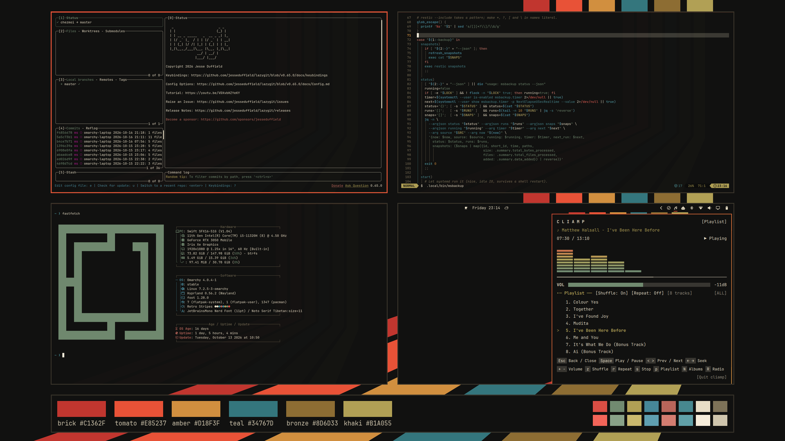
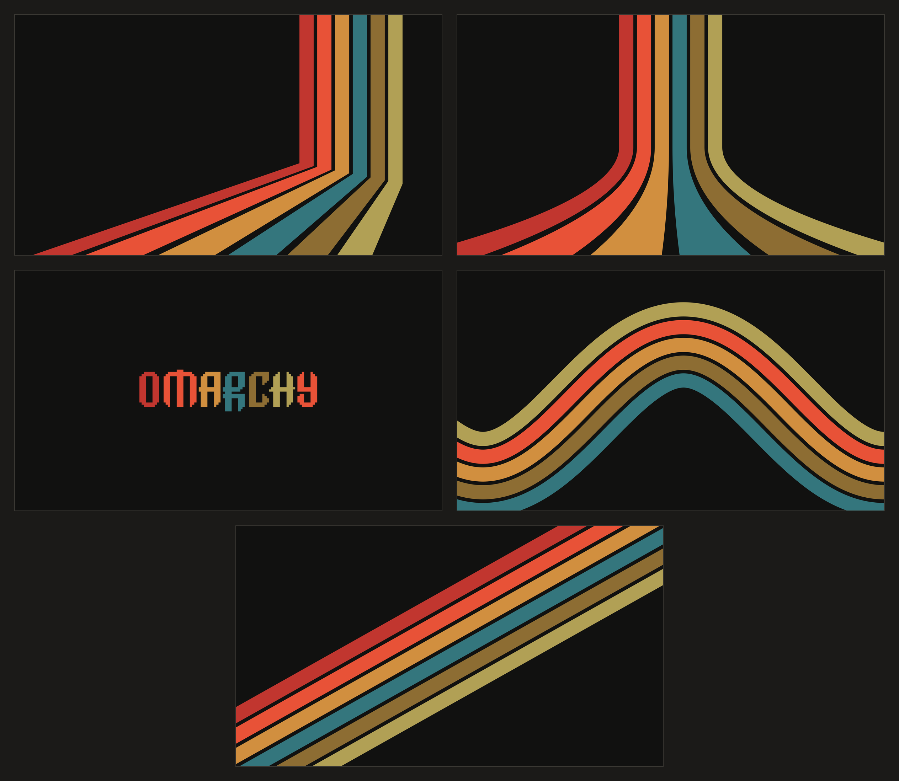

# Retro Stripes

A warm, dark [Omarchy](https://omarchy.org) theme: six seventies stripes on near-black.



## Install

```bash
omarchy theme install https://github.com/MatthiasStaber/omarchy-retro-stripes-theme
```

## Palette

| Stripe | Hex |
|---|---|
| brick | `#C1362F` |
| tomato (accent) | `#E85237` |
| amber | `#D18F3F` |
| teal | `#34767D` |
| bronze | `#8D6D33` |
| khaki | `#B1A055` |

Background `#111110`, foreground `#e8dec6`. The terminal's green, blue and magenta are
derived from the stripes; every ANSI colour has at least 4.5:1 contrast on the background.

## Wallpapers



- `1-retro-stripes-fan.png`: the stripes fan out to the lower left (default)
- `2-retro-stripes-flare.png`: symmetric flare
- `3-retro-stripes-logo.png`: the Omarchy wordmark, one stripe colour per letter
- `4-retro-stripes-wave.png`: the stripes rise and fall in one wave
- `5-retro-stripes-diagonal.png`: a diagonal band across the screen

All 3840×2160. Cycle through them with Super+Ctrl+Space, or pick one in the background menu.

## License

MIT
