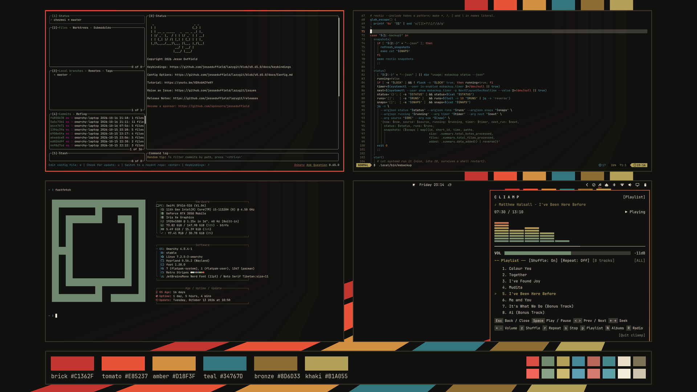
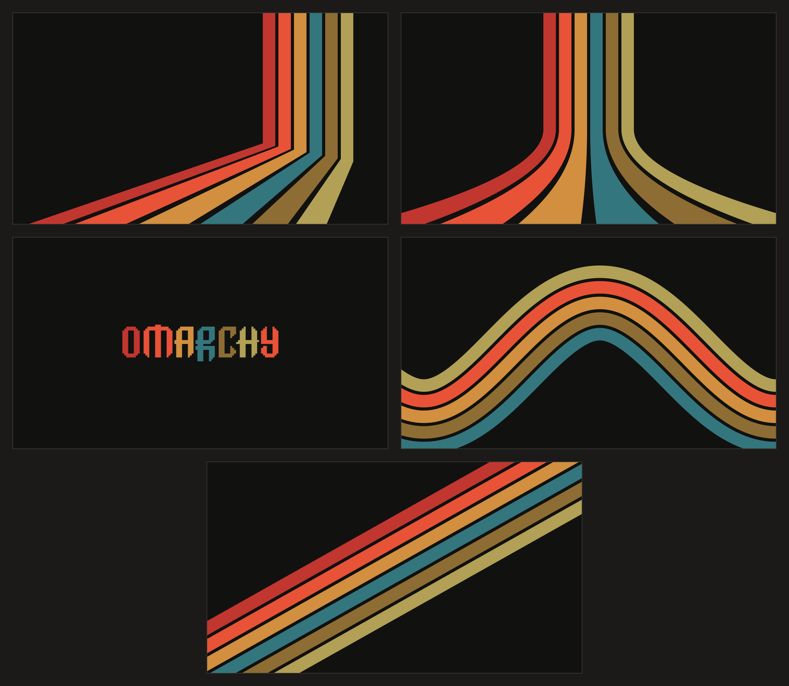

# Retro Stripes

A warm, dark [Omarchy](https://omarchy.org) theme: six seventies stripes on near-black.



## Install

```bash
omarchy theme install https://github.com/MatthiasStaber/omarchy-retro-stripes-theme
```

## Palette

| Stripe | Hex |
|---|---|
| brick | `#C1362F` |
| tomato (accent) | `#E85237` |
| amber | `#D18F3F` |
| teal | `#34767D` |
| bronze | `#8D6D33` |
| khaki | `#B1A055` |

Background `#111110`, foreground `#e8dec6`. The terminal's green, blue and magenta are
derived from the stripes; every ANSI colour has at least 4.5:1 contrast on the background.

## Wallpapers



- `1-retro-stripes-fan.png`: the stripes fan out to the lower left (default)
- `2-retro-stripes-flare.png`: symmetric flare
- `3-retro-stripes-logo.png`: the Omarchy wordmark, one stripe colour per letter
- `4-retro-stripes-wave.png`: the stripes rise and fall in one wave
- `5-retro-stripes-diagonal.png`: a diagonal band across the screen

All 3840×2160. Cycle through them with Super+Ctrl+Space, or pick one in the background menu.

Each wallpaper has a short intro in `backgrounds/intros/`: the stripes swipe in along their
path (the logo burns in like the wordmark lock screen). Omarchy plays it at login and when you switch to
the theme. Turn intros off with `omarchy theme bg intro disable`.

## Lock screen (optional)

`lock/` holds a lock screen to match: the OMARCHY wordmark from the logo wallpaper burns in
from the bottom when the screen locks and burns away as smoke when you unlock. The clock sits
under it, and the password shows as squares in the six stripe colours. It is Omarchy's own lock
(same password and fingerprint handling) with a new look, and it only changes anything while
Retro Stripes is the active theme.

It is a shell plugin, so it is not installed with the theme. After installing the theme:

```bash
cp -r ~/.config/omarchy/themes/retro-stripes/lock ~/.config/omarchy/plugins/retro-stripes.lock
omarchy-shell shell rescanPlugins
omarchy plugin enable retro-stripes.lock
```

Try it with `omarchy-shell lock preview` (click to close) before you lock for real.
To go back to the stock lock: `omarchy plugin remove retro-stripes.lock`.

Built on Omarchy 4.5.0's lock plugin. After an Omarchy update that changes the stock lock,
check this repo for a new version.

## License

MIT. `lock/` is based on Omarchy's lock plugin, also MIT; its notice is in
`lock/LICENSE-omarchy`.
